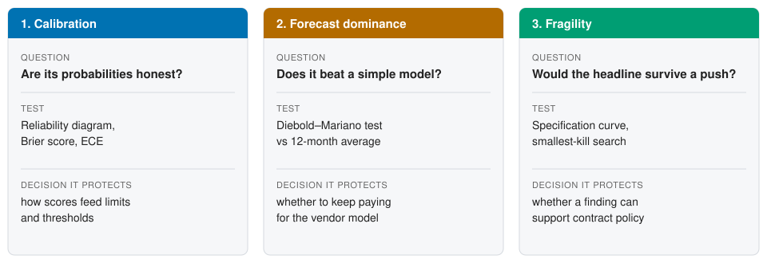

```{r}
#| include: false
source("R/common.R")
panel <- read.csv("data/vendor_panel.csv")
```

## Hook

Your bank pays a vendor for a number. Every month, a model called VendorScore hands
NorthPoint Bank a risk score for each of its `r length(unique(panel$vendor_id))` third-party
vendors. Nobody at the bank can see the code, the training data, or the method. The
scores simply arrive, and decisions follow them.

How do you validate something you cannot open? This series shows that a great deal can be
learned from the outside, using only the scores and what happens afterwards. It also shows
where outside testing stops.

## The three questions

The April 2026 interagency *Supervisory Guidance on Model Risk Management* (Federal Reserve,
FDIC, OCC) is explicitly non-prescriptive. We read it as describing sound practice, not
rules. Three questions follow from it, and each one works on any risk model, whether bought
or built.

1. **Are its probabilities honest?** When the model says 10%, do incidents happen about 10%
   of the time? This is calibration, tested with the `probcal` package ([Page 2](calibration.qmd)).
2. **Does it beat a simple model?** A sophisticated model should outperform a plain
   12-month average, and keep doing so when conditions change. This is forecast dominance,
   tested with `forecastdom` ([Page 3](forecast.qmd)).
3. **Would its headline finding survive a push?** Some findings collapse under a small
   change of method or data. This is fragility, tested with `falsifyr` ([Page 4](fragility.qmd)).

{#fig-overview fig-alt="Three panels. Calibration asks whether probabilities are honest. Forecast dominance asks whether the model beats a simple one. Fragility asks whether the headline survives a push."}

::: {.reader-note}
**How to read the plot.** Each of the three columns is one question. Reading down a
column, you see the question, the test used to answer it, and the decision that test
protects.

**What the plot tells you.** The three tests are not interchangeable: each guards a
different business decision. A model can pass one and fail another, so a validation that
runs only one test leaves two decisions unprotected.
:::

::: {.callout-note appearance="simple" icon="false"}
## Materiality box (illustrative ratings)

Guidance factors for judging how much validation a model deserves:

- **Inherent risk: high.** Scores drive vendor oversight where vendors hold client data.
- **Exposure: broad.** The score covers the whole portfolio of `r length(unique(panel$vendor_id))` vendors.
- **Purpose: consequential.** Scores inform monitoring intensity and contract terms.

Conclusion: full validation is warranted.
:::

## The case

NorthPoint Bank is a fictional regional bank with about $45 billion in assets. The
guidance targets banks above $30 billion; asset managers and fintechs can adopt the same
practices voluntarily.

All four pages share one synthetic dataset: `r nrow(panel)` vendor-months (300 vendors over
48 months, January 2022 to December 2025), with `r sum(panel$incident)` observed incidents,
or `r pct(mean(panel$incident), 2)` of vendor-months. Because the data are simulated, we also
know each vendor-month's true incident probability, and we use it only as a reference
standard. The models under test never see it. Everything is reproducible from seed 34.

A fictional vendor, RiskMetric Systems, supplies VendorScore. It trained on months 1 to 30.
NorthPoint evaluates it on months 31 to 48, a period that includes a deterioration in
vendors' patching speed after month 36.

## The black-box problem

Guidance on vendor products (§VII) recognises that a bank may lack access to a vendor
model's inner workings. The vendor's summary offers only a claim of "ensemble machine
learning on proprietary threat intelligence," an AUC of 0.81 "on vendor development data,"
and the assertion that scores are "well-calibrated." The bank can test none of this
directly.

What the bank does have is its own outcomes. Testing scores against outcomes is partial
validation only. It cannot confirm that the proprietary model is conceptually sound; that
depends on what the vendor discloses. Each page repeats this limit, and so should any
committee that relies on these results.

## How to read this series

Pages 2 to 4 share one structure: the question, the method in brief, the findings, what
they mean for the bank, and one committee action phrased as "sound practice suggests…".
The expected findings were written as hypotheses before any analysis ran. Where a result
differs from the hypothesis, the text reports the result.

Code is folded by default; click "Show the code" to see it. Page 4 closes with a scorecard
that gathers the measured results from all three tests.
